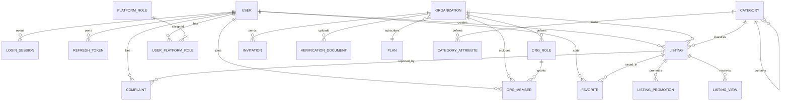

# Архитектура

## 1. Назначение и ограничения

BizBoard — backend B2B-площадки объявлений. Система должна:

- авторизовывать пользователей через Telegram без пароля и SMS;
- поддерживать организации, сотрудников, собственные роли и верификацию;
- вести каталог до трёх уровней с наследуемыми атрибутами;
- публиковать 8 типов объявлений после модерации;
- обеспечивать полнотекстовый поиск с p95 < 300 мс на 50 000 объявлений;
- скрывать контакты объявлений от неавторизованных пользователей;
- давать администраторам отдельный API с обязательным TOTP.

В MVP **нет** платежей, чата, мобильного приложения и автоматического
продвижения. Тарифы и промо-позиции назначаются вручную через админ-API.

## 2. Стиль архитектуры

Выбран **модульный монолит** на FastAPI:

- один деплой-артефакт и одна база данных;
- доменные модули разделены по слоям и не ходят друг к другу через HTTP;
- асинхронный ввод-вывод на всех уровнях (FastAPI, SQLAlchemy async, Redis,
  httpx, aiofiles);
- выделение сервисов в отдельные процессы возможно позже без переписывания
  доменной логики.

```text
                       ┌──────────────────────────────┐
  Telegram Bot  ──────▶│  POST /telegram/webhook      │
                       └──────────────┬───────────────┘
                                      │
  Web / mobile  ─────────────────────▶│  FastAPI (app/main.py)
                                      │
                 ┌────────────────────┼────────────────────┐
                 ▼                    ▼                    ▼
          API routers           Dependencies          Exception handlers
          app/api/v1/*          auth, DB, perms       единый формат ошибок
                 │
                 ▼
          Service layer
          auth, org, catalog, listing, search
                 │
        ┌────────┴─────────┐
        ▼                  ▼
  SQLAlchemy async     Redis cache
        │              (permissions, limits)
        ▼
  PostgreSQL 16
  JSONB + tsvector + GIN
        │
        ▼
  Local media (MVP) ──▶ object storage (рекомендация для production)
```

## 3. Структура кода

```text
app/
  main.py              создание приложения, lifespan, health/ready, /media
  api/
    deps.py            зависимости: БД, JWT, платформенные права
    v1/
      router.py        сборка публичных роутеров
      auth.py          Telegram-вход, refresh, TOTP
      users.py         профиль и избранное
      organizations.py организации, роли, участники, документы
      invitations.py   принятие приглашения
      catalog.py       публичный каталог
      listings.py      объявления, поиск, жалобы, избранное
      uploads.py       загрузка файлов
      public.py        публичные организации
      meta.py          справочники и тарифы
      telegram.py      webhook
      admin/           админ-API
  core/
    config.py          настройки из .env
    database.py        engine, session, Base, JSONB
    cache.py           Redis + memory fallback
    security.py        JWT, хеши токенов
    totp.py            TOTP и шифрование секретов
    permissions.py     коды прав и шаблоны ролей
    reference.py       справочники регионов, типов, статусов
    rate_limit.py      лимиты через Redis
    storage.py         сохранение файлов
    errors.py          AppError и обработчики
    audit.py           запись в audit_logs
    telegram.py        клиент Bot API
  models/              SQLAlchemy-модели
  schemas/             Pydantic-схемы запросов и ответов
  services/            бизнес-логика
  seed.py              идемпотентный seed
alembic/               миграции
scripts/               эксплуатационные скрипты
tests/                 unit и integration тесты
docs/                  документация
```

### Правила зависимостей

```text
api ──▶ services ──▶ models
 │          │
 │          └────▶ core
 └──────────────▶ schemas
```

- `api` не содержит бизнес-правил: валидация, вызов сервиса, сериализация.
- `services` не знают о FastAPI и HTTP-статусах, кроме доменного `AppError`.
- `models` не импортируют `services`.
- `schemas` не содержат логики доступа к БД.
- `core` не зависит от доменных моделей, кроме общих утилит.

## 4. Жизненный цикл запроса

1. Uvicorn принимает HTTP-запрос.
2. CORS middleware применяет настройки `CORS_ORIGINS`.
3. FastAPI разрешает зависимости:
   - `get_db` открывает `AsyncSession`;
   - `get_auth` / `get_optional_auth` декодирует JWT, загружает пользователя,
     проверяет блокировку;
   - `require_platform_permission` проверяет `mfa=true` и платформенное право;
   - `require_org_permission` проверяет участие и права в организации.
4. Роутер валидирует Pydantic-схему и вызывает сервис.
5. Сервис выполняет бизнес-правила, пишет изменения и коммитит транзакцию.
6. Сериализатор формирует ответ, скрывая контакты при необходимости.
7. Любое исключение превращается в единый JSON-конверт ошибки.

Транзакция обычно ограничена одним сервисным вызовом. Административные
изменения дополнительно пишут запись в `audit_logs` в той же транзакции.

## 5. Аутентификация

### 5.1. Вход через Telegram deep-link

```text
Клиент                     API                         Telegram
  │  POST /auth/telegram/start │                            │
  │───────────────────────────▶│ создаёт LoginSession       │
  │◀───────────────────────────│ token + t.me/...?start=... │
  │  открывает ссылку ────────────────────────────────────▶│
  │                            │◀── webhook /start login_...│
  │                            │ подтверждает сессию,       │
  │                            │ создаёт/находит User       │
  │  POST /auth/telegram/poll  │                            │
  │───────────────────────────▶│ pending → confirmed        │
  │◀───────────────────────────│ access + refresh + user    │
```

- Одноразовый `token` живёт `LOGIN_SESSION_TTL_MINUTES` (по умолчанию 10 минут).
- В БД хранится только SHA-256 от токена сессии.
- Телефон приходит из Telegram и считается подтверждённым.
- При входе автоматически принимаются ожидающие приглашения, адресованные
  этому `telegram_id`.

### 5.2. JWT

Access-токен:

```json
{
  "sub": "<user uuid>",
  "type": "access",
  "mfa": false,
  "jti": "<random hex>",
  "iat": 1760000000,
  "exp": 1760000900
}
```

- Алгоритм HS256, ключ `SECRET_KEY`.
- Время жизни — `ACCESS_TOKEN_TTL_MINUTES` (15 минут).
- `mfa=true` появляется только после успешной проверки TOTP.

Refresh-токен — случайная строка, в БД хранится SHA-256. При обновлении:

1. старый токен помечается `revoked_at`;
2. выпускается новый в том же `family_id`;
3. при повторном использовании старого токена отзывается всё семейство.

### 5.3. TOTP для администраторов

- Настроить TOTP может только пользователь с платформенной ролью.
- Секрет шифруется Fernet-ключом, производным от `SECRET_KEY`.
- `POST /auth/totp/setup` возвращает секрет и `otpauth://`-ссылку.
- `POST /auth/totp/enable` подтверждает код и выдаёт токены с `mfa=true`.
- `POST /auth/totp/verify` используется при последующих входах.
- Админ-API возвращает `403 mfa_required`, если в токене `mfa=false`.

## 6. Авторизация

### 6.1. Платформенные роли

Роли хранятся в `platform_roles`, связь с пользователем — `user_platform_roles`.
Разрешения — плоские коды:

`users.view`, `users.block`, `orgs.verify`, `listings.moderate`,
`complaints.handle`, `catalog.manage`, `roles.manage_platform`, `plans.manage`,
`audit.view`, `settings.manage`.

Шаблоны при seed: `superadmin`, `moderator`, `support`.

### 6.2. Организационные роли

- Владелец (`org_members.is_owner=true`) имеет все права.
- Остальные сотрудники получают права из `org_roles.permissions`.
- Коды прав: `listing.create`, `listing.edit`, `listing.publish`,
  `listing.delete`, `listing.view_stats`, `listing.promote`,
  `org.edit_profile`, `org.manage_contacts`, `org.manage_members`,
  `org.manage_roles`, `review.reply`, `billing.view`, `billing.manage`.
- Нельзя выдать роли право, которого нет у выдающего (`permission_escalation`).
- Права кэшируются в Redis на 5 минут и инвалидируются при изменении роли,
  удалении сотрудника и принятии приглашения.

## 7. Доменная модель



Ключевые агрегаты:

- **User** — учётная запись Telegram, профиль, платформенные роли, TOTP.
- **Organization** — компания, тариф, верификация, возможности, участники.
- **Catalog** — дерево категорий и атрибуты с наследованием.
- **Listing** — объявление, модерация, контакты, просмотры, продвижение.
- **Moderation** — жалобы, документы, аудит.

Подробное описание таблиц: [database.md](database.md).

## 8. Каталог и атрибуты

- Максимальная глубина — 3 уровня; попытка создать 4-й уровень возвращает
  `category_depth_exceeded`.
- Атрибуты задаются на категории и наследуются всеми потомками.
- При конфликте ключа побеждает атрибут ближайшего предка.
- Типы атрибутов: `string`, `number`, `enum`, `multi_enum`, `bool`, `range`,
  `date`.
- Обязательные атрибуты проверяются при создании, обновлении и повторной
  отправке объявления на модерацию.
- Значения хранятся в `listings.attributes` (JSONB).

## 9. Поиск

Публичная выдача:

- только `status=active`, без `deleted_at`, с неистёкшим `expires_at`;
- фильтры по категории включают всех потомков;
- фильтры по типу, региону, цене, организации;
- атрибутные фильтры: `attr.<key>=<value>`, `attr.<key>.min`, `attr.<key>.max`;
- сортировки: `date`, `price_asc`, `price_desc`, `relevance`;
- в сортировке по умолчанию сначала идут активные `top`-продвижения, затем
  `bumped_at`, затем дата публикации.

На PostgreSQL полнотекстовый поиск использует:

```sql
to_tsvector('russian', title || ' ' || description)
```

и GIN-индекс `ix_listings_fts`, созданный миграцией. На SQLite (тесты)
используется `ILIKE`, чтобы сценарии работали без PostgreSQL.

Оценка производительности и рекомендации — в
[deployment.md](deployment.md#производительность-и-масштабирование).

## 10. Кэш и лимиты

Redis используется для:

- кэша прав организации: `perms:org:<org_id>:user:<user_id>`, TTL 5 минут;
- счётчиков rate limit: `ratelimit:<key>`, TTL = окно.

При недоступности Redis приложение не падает, а переключается на
внутрипроцессный кэш. Это допустимо для разработки, но **не для production**:
лимиты и кэш не будут общими между воркерами. `/ready` показывает
`cache_fallback=true`.

## 11. Фоновые задачи

В MVP фоновые задачи вынесены в скрипты:

- `python -m scripts.expire_listings` — перевод просроченных объявлений в
  `expired`; запускать каждые 10–15 минут.

Для production можно добавить Celery/ARQ для:

- уведомлений в Telegram;
- напоминаний об истечении объявления;
- пересчёта поисковых индексов;
- очистки старых `login_sessions` и `refresh_tokens`.

## 12. Принятые решения и компромиссы

| Решение | Причина | Компромисс |
|---|---|---|
| Модульный монолит | Скорость разработки, простой деплой | Нет независимого масштабирования модулей |
| JWT + refresh в БД | Stateless access, контроль сессий | Нужна БД для refresh |
| TOTP вместо SMS | Нет зависимости от SMS-шлюза | Администратор должен настроить приложение |
| JSONB для атрибутов | Гибкий каталог без миграций | Слабее типизация, нужна валидация в сервисе |
| PostgreSQL FTS | Без отдельного поискового кластера | Меньше возможностей, чем у Elasticsearch |
| Локальное media | Простой MVP | Нужен object storage при горизонтальном масштабировании |
| Redis-кэш прав | Быстрая проверка на каждом запросе | Возможна задержка инвалидации до TTL |

## 13. Что не входит в MVP

- онлайн-оплата тарифов и продвижения;
- чат между пользователями;
- мобильное приложение;
- автоматическая проверка ИНН через внешний реестр;
- геопоиск и карты;
- рекомендации и ML-ранжирование;
- мультиязычность;
- webhooks для внешних интеграций.
