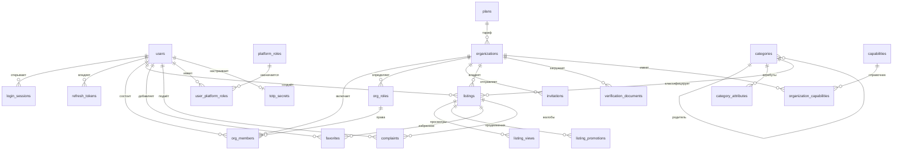

# База данных

СУБД: **PostgreSQL 16**. Доступ через SQLAlchemy 2 async + asyncpg.
Тесты используют SQLite (aiosqlite), поэтому схема должна оставаться
переносимой; PostgreSQL-специфичные индексы создаются в миграции.

## 1. Общая схема



## 2. Таблицы

### 2.1. Пользователи и доступ

| Таблица | Назначение | Ключевые поля |
|---|---|---|
| `users` | Учётные записи | `telegram_id` (unique), `phone` (unique), `email` (unique), `status`, `notification_settings` |
| `platform_roles` | Платформенные роли | `code` (unique), `permissions` JSONB, `is_system` |
| `user_platform_roles` | Связь M:N | PK (`user_id`, `role_id`), `assigned_by` |
| `totp_secrets` | TOTP | PK `user_id`, `secret_encrypted`, `enabled` |
| `login_sessions` | Одноразовые сессии входа | `token_hash` (unique), `status`, `expires_at`, `user_id` |
| `refresh_tokens` | Refresh-сессии | `token_hash` (unique), `family_id`, `mfa`, `revoked_at`, `replaced_by_id` |
| `audit_logs` | Аудит действий | `actor_id`, `action`, `entity_type`, `entity_id`, `payload` JSONB, `ip` |
| `uploaded_files` | Метаданные файлов | `owner_id`, `kind`, `path`, `url`, `is_public` |
| `platform_settings` | Настройки | PK `key`, `value` JSONB |

Особенности:

- `refresh_tokens.family_id` объединяет цепочку ротаций. При повторном
  использовании отозванного токена отзывается всё семейство.
- `login_sessions.token_hash` — SHA-256, сам токен в БД не хранится.
- `totp_secrets.secret_encrypted` — Fernet-шифртекст, ключ производный от
  `SECRET_KEY`. При смене `SECRET_KEY` существующие TOTP-секреты перестанут
  расшифровываться.

### 2.2. Организации

| Таблица | Назначение | Ключевые поля |
|---|---|---|
| `organizations` | Компании | `slug` (unique), `inn` (unique), `ogrn` (unique), `type`, `region`, `status`, `verification_level`, `plan_id` |
| `org_members` | Сотрудники | unique (`organization_id`, `user_id`), `role_id`, `is_owner`, `status` |
| `org_roles` | Роли организации | unique (`organization_id`, `name`), `permissions` JSONB, `is_system` |
| `invitations` | Приглашения | `token_hash` (unique), `telegram_id`, `status`, `expires_at` |
| `verification_documents` | Документы | `organization_id`, `kind`, `status`, `file_url` |
| `capabilities` | Справочник возможностей | PK `code`, `param_schema` JSONB |
| `organization_capabilities` | Возможности организации | `organization_id`, `code`, `params` JSONB |
| `plans` | Тарифы | `code` (unique), `max_active_listings`, `price`, `features` JSONB |

Особенности:

- `org_members.is_owner=true` даёт все организационные права.
- При удалении сотрудника запись не удаляется, а получает
  `status=removed`; это позволяет повторно пригласить пользователя.
- `organizations.verification_level` — денормализованный уровень:
  `none` → `phone` → `inn` → `moderator`.
- ИНН уникален; `NULL` не участвует в проверке уникальности PostgreSQL.

### 2.3. Каталог и объявления

| Таблица | Назначение | Ключевые поля |
|---|---|---|
| `categories` | Дерево категорий | `slug` (unique), `parent_id`, `allowed_types` JSONB, `is_active` |
| `category_attributes` | Атрибуты | `category_id`, `key`, `type`, `options` JSONB, `is_required` |
| `listings` | Объявления | `category_id`, `type`, `region`, `status`, `attributes` JSONB, `price`, `expires_at` |
| `listing_views` | Просмотры | `listing_id`, `user_id`, `ip_hash`, `created_at` |
| `listing_promotions` | Продвижения | `listing_id`, `type`, `starts_at`, `ends_at` |
| `favorites` | Избранное | unique (`user_id`, `listing_id`) |
| `complaints` | Жалобы | `listing_id`, `complainant_id`, `reason`, `status`, `handled_by` |

Особенности:

- `listings.attributes` — JSONB-объект, ключи соответствуют
  `category_attributes.key`, включая унаследованные атрибуты.
- `listings.deleted_at` — мягкое удаление. Публичная выдача и админ-списки
  исключают такие записи.
- `listings.expires_at` проверяется в поиске и в скрипте
  `scripts/expire_listings.py`.
- `listing_views.ip_hash` — SHA-256 от IP, сырой IP не хранится.
- `favorites` имеет уникальную пару, повторное добавление идемпотентно.
- `complaints.listing_id` и `organization_id` могут быть `NULL` для жалоб на
  пользователя в будущем; в MVP жалоба всегда создаётся на объявление.

## 3. Перечисления

Все перечисления хранятся как `VARCHAR` с ограничением на уровне приложения
(`enum_type`). Значения:

| Перечисление | Значения |
|---|---|
| `UserStatus` | `active`, `blocked` |
| `OrgType` | `legal_entity`, `sole_proprietor`, `self_employed` |
| `OrgStatus` | `active`, `blocked` |
| `VerificationLevel` | `none`, `phone`, `inn`, `moderator` |
| `MemberStatus` | `active`, `removed` |
| `InvitationStatus` | `pending`, `accepted`, `revoked`, `expired` |
| `DocumentStatus` | `pending`, `approved`, `rejected` |
| `DocumentKind` | `egrul`, `egrip`, `self_employed`, `other` |
| `ListingType` | `sale`, `rent_out`, `wanted_buy`, `wanted_rent`, `service_offer`, `service_wanted`, `tender`, `partnership` |
| `ListingStatus` | `draft`, `pending`, `active`, `rejected`, `archived`, `expired`, `blocked` |
| `PromotionType` | `top`, `highlight`, `bump` |
| `ComplaintStatus` | `new`, `in_review`, `resolved`, `rejected` |
| `AttributeType` | `string`, `number`, `enum`, `multi_enum`, `bool`, `range`, `date` |
| `Region` | `dnr`, `lnr`, `kherson`, `zaporozhye` |
| `LoginStatus` | `pending`, `confirmed`, `consumed`, `expired` |

## 4. Индексы

Основные индексы:

| Индекс | Таблица | Назначение |
|---|---|---|
| `ix_listings_fts` | `listings` | GIN по `to_tsvector('russian', title \|\| ' ' \|\| description)` |
| `ix_listings_attributes` | `listings` | GIN по JSONB `attributes` |
| `ix_listings_status_published` | `listings` | Выдача по статусу и дате |
| `ix_listings_category_status` | `listings` | Фильтр по категории |
| `ix_listings_region_status` | `listings` | Фильтр по региону |
| `ix_listings_org_status` | `listings` | Объявления организации |
| `ix_org_members_user_status` | `org_members` | Проверка участия |
| `ix_invitations_org_status` | `invitations` | Список приглашений |
| `ix_listing_views_listing_created` | `listing_views` | Статистика за период |
| `ix_complaints_status_created` | `complaints` | Очередь жалоб |
| `uq_favorites_user_listing` | `favorites` | Защита от дублей |

`ix_listings_fts` создаётся только в PostgreSQL-миграции:

```sql
CREATE INDEX IF NOT EXISTS ix_listings_fts
ON listings USING gin (to_tsvector('russian', title || ' ' || description));
```

На SQLite этот индекс не создаётся, поиск использует `ILIKE`.

## 5. JSONB-структуры

### 5.1. Атрибуты объявления

```json
{
  "condition": "used",
  "year": 2020,
  "power_kw": 15.5,
  "warranty": true
}
```

Ключи и типы определяются каталогом. Валидация выполняется в
`catalog_service.validate_listing_attributes`.

### 5.2. Атрибут категории

```json
{
  "key": "condition",
  "name": "Состояние",
  "type": "enum",
  "unit": null,
  "is_required": true,
  "is_filterable": true,
  "options": [
    {"value": "new", "label": "Новое"},
    {"value": "used", "label": "Б/у"}
  ],
  "sort_order": 1
}
```

### 5.3. Права роли

```json
["listing.create", "listing.edit", "listing.publish"]
```

### 5.4. Возможности организации

```json
{
  "zones": "ДНР, ЛНР",
  "same_day": true
}
```

Схема параметров задаётся в `capabilities.param_schema`.

### 5.5. Настройки пользователя

```json
{
  "new_listing_moderated": true,
  "new_complaint": true,
  "new_invitation": true,
  "listing_expiring": true
}
```

### 5.6. Тариф

```json
{
  "promotion": true,
  "support": "email"
}
```

## 6. Миграции

Инструмент: Alembic, асинхронный `env.py`.

```bash
# применить все миграции
alembic upgrade head

# откатить последнюю
alembic downgrade -1

# откатить всё
alembic downgrade base

# создать новую миграцию вручную
alembic revision -m "add something"

# автогенерация (проверяйте diff!)
alembic revision --autogenerate -m "add something"
```

Правила:

- В production `AUTO_CREATE_TABLES=false`; схема создаётся только Alembic.
- Перед деплоем миграции проверяются на копии БД.
- Откат (`downgrade`) должен быть реализован для каждой миграции.
- PostgreSQL-специфичные индексы создаются с проверкой диалекта.
- Изменения JSONB-структур не требуют миграции, но требуют валидации в коде.

## 7. Транзакции и конкурентность

- Одна HTTP-операция — одна или несколько коротких транзакций.
- Refresh-токены читаются с `SELECT ... FOR UPDATE`, чтобы ротация была
  атомарной.
- Уникальные ограничения защищают от гонок: `users.phone`,
  `organizations.inn`, `org_members (organization_id, user_id)`,
  `favorites (user_id, listing_id)`.
- Лимит публикаций проверяется перед сменой статуса; при высокой нагрузке
  возможна гонка, поэтому в будущем стоит добавить блокировку организации
  или счётчик в Redis.
- `updated_at` обновляется на стороне БД (`onupdate=func.now()`).

## 8. Хранение и очистка

Рекомендуемая политика:

| Данные | Срок |
|---|---|
| `login_sessions` | удалять через 7 дней после истечения |
| `refresh_tokens` | удалять отозванные/истёкшие через 90 дней |
| `listing_views` | агрегировать или удалять старше 12 месяцев |
| `audit_logs` | хранить 12–24 месяца |
| `uploaded_files` | удалять вместе с объявлением/организацией по регламенту |
| Бэкапы PostgreSQL | ежедневно, хранить 14 дней |

Мягко удалённые объявления (`deleted_at`) физически не удаляются автоматически.
Для очистки нужен отдельный скрипт/задача.

## 9. Бэкапы и восстановление

```bash
# дамп
pg_dump --format=custom --file=bizboard-$(date +%F).dump "$DATABASE_URL"

# восстановление в чистую БД
pg_restore --clean --if-exists --dbname="$DATABASE_URL" bizboard-2026-11-13.dump
```

Проверяйте восстановление минимум раз в месяц на отдельном стенде.
Медиафайлы бэкапятся отдельно (rsync/S3 versioning).
